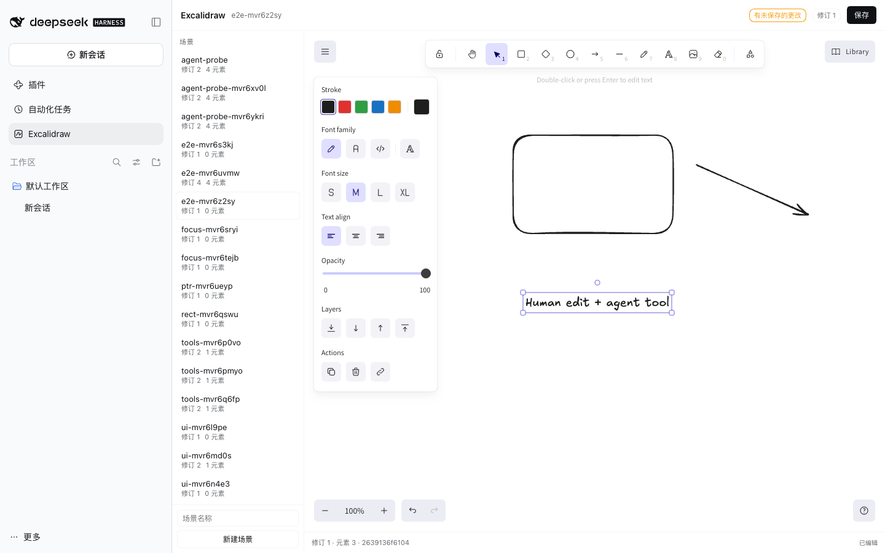

# DSH Excalidraw

A native [DeepSeek Harness](https://github.com/deepseek-ai/deepseek-harness) plugin that brings the core drawing capabilities of Obsidian Excalidraw to the Harness: a **real, interactive Excalidraw canvas**, **durable `.excalidraw` file persistence with revision fences**, and **typed agent tools** that create and edit the same scenes the person is looking at.

> **中文摘要**：本项目不是把 Obsidian 插件整体搬进 Harness，也不是桥接 Obsidian。它用 MIT 许可的上游 Excalidraw 渲染器 + 原创的 MIT 场景核心，实现 Harness 原生插件：可交互画布、带修订号与幂等重试的文件持久化、5 个带 JSON Schema 与权限边界的 Agent 工具。仓库包含原始源码证据、三方案对比、ADR、黄金语料、56 个自动化测试、13 步真实浏览器 E2E 和真实 Host 工具调用探针。详见 [docs/00-index.md](docs/00-index.md)。



## Status

- **Version:** 0.1.0 (MVP, architecture and verification complete)
- **Target:** DeepSeek Harness **0.2.1-rc.2** (verified live) with the plugin contract of the Harness 0.2.x client-modules loader
- **Renderer:** `@excalidraw/excalidraw@0.18.1` (MIT), React 18 from the Harness page module table
- **Verification:** 56 automated Host/core tests, 13-step real-browser E2E, 5 agent tools executed inside a real isolated Harness Host, golden corpus generated with the MIT Excalidraw runtime
- **What this is:** an installable DSH plugin and a DSH-native drawing editor
- **What this is not:** an Obsidian bridge, a standalone web app, or a copy of the AGPL Obsidian plugin

## What it does

| Capability | Implementation | Evidence |
|---|---|---|
| Install / load / unload / configure through the official plugin mechanism | One bundle row in `cordis.patch.yml`; every resource is a `ctx.effect`; config clamped in `apply` | [platform evidence](docs/02-dsh-platform.md), [lifecycle tests](test/unit/lifecycle.test.ts), [verification](docs/08-verification.md) |
| View and interactively edit supported Excalidraw scenes | Genuine `@excalidraw/excalidraw` component registered in the Harness `main` panel, with a sidebar entry | [render spike](docs/05-render-spike.md), E2E screenshots |
| Agent creates / reads / modifies drawings through typed, permissioned tools | Five JSON-Schema tools backed by the same service the UI uses | [agent probe](docs/evidence/verification/agent-probe-report.json), [contract](docs/07-capability-contract.md) |
| Reliable save, reopen, and structural fidelity | Atomic write + fsync + read-back hash verification, sidecar revision, idempotent request ids, conflict recovery, backup recovery | [store tests](test/unit/store.test.ts), [E2E](test/e2e/dsh-ui.e2e.mjs), [golden corpus](test/integration/fixtures.test.ts) |

## Architecture

```
┌──────────────────────────── Harness page (browser) ────────────────────────────┐
│  sidebar.panellist icon  ──►  main panel: ExcalidrawPage                      │
│                                   ├─ genuine Excalidraw canvas (React 18)     │
│                                   ├─ scene list, save, conflict banner         │
│                                   └─ same-origin fetch (session cookie)        │
└───────────────────────────────────────┬────────────────────────────────────────┘
                                        │  /dsh-excalidraw/api/*  (connection fence)
┌───────────────────────────────────────▼────────────────────────────────────────┐
│  Host half (Cordis plugin, Node)                                               │
│  ExcalidrawService ── SceneStore (atomic + revision + lock + backups)          │
│        │                     │                                                 │
│        ├─ 5 agent tools      └─ <DSH_HOME>/excalidraw/drawings/*.excalidraw    │
│        └─ /dsh-excalidraw/assets/*  (fonts, locale chunks, CSS)                │
└────────────────────────────────────────────────────────────────────────────────┘
```

Two halves in one npm package:
- **Host** (`lib/index.js`): scene store, HTTP API, asset route, agent tools. Zero runtime dependencies; Node built-ins only.
- **Client** (`lib/client.js`): the loader-format bundle (`window.__ModuleLoader__.load({id, factory(require)})`) with React external. It contains Excalidraw 0.18.1, the page UI, and the stylesheet text.

## Install

The built `lib/` and `assets/` directories are committed, so installation needs no build step and no network.

**DSH Desktop / plugin manager** — install the repository directory as a bundle:

```text
plugin_manager install_bundle  target: /absolute/path/to/dsh-excalidraw
```

Or from the CLI in a profile:

```sh
dsh plugin --profile <profile> add /absolute/path/to/dsh-excalidraw
```

The bundle adds `dsh-excalidraw` to `dsh.profile.bundles`. A newly installed package may require a Harness restart; the plugin manager reports `restart-required` with the reason. After restart, open **Excalidraw** in the left sidebar.

### Configuration

The row in `cordis.patch.yml` exposes the tunables; user overrides belong in the profile's own `cordis.patch.yml`.

```yaml
- id: dsh-excalidraw
  name: 'dsh-excalidraw'
  config:
    drawingsDir: ''            # default: <DSH_HOME>/excalidraw/drawings
    maxSceneBytes: 16777216    # 1 MiB .. 64 MiB
    maxElements: 5000          # 1 .. 20000
    maxFiles: 64               # 0 .. 256
    maxTextLength: 20000       # 100 .. 100000
```

There is deliberately no `engines.dsh` range yet: the plugin was verified on 0.2.1-rc.2 and adding an untested range would claim compatibility the evidence does not cover.

## Use

### Person

1. Click **Excalidraw** in the sidebar.
2. Enter a lowercase scene name and click **New scene**.
3. Draw with the Excalidraw toolbar; **Save** (or `Cmd/Ctrl+S`) writes the file.
4. If an agent or another writer changed the scene, the save returns a conflict banner: **Reload from disk** keeps their version, **Overwrite anyway** writes yours as the next revision.

### Agent

The five tools are visible to every agent in the profile:

| Tool | Purpose | Key arguments |
|---|---|---|
| `excalidraw_scene_list` | Discover scenes | — |
| `excalidraw_scene_read` | Read scene + revision + sha256 | `name`, `include` (`full`/`summary`), `element_type` |
| `excalidraw_scene_create` | Create a scene from typed elements | `name`, `elements`, `app_state`, `files`, `request_id` |
| `excalidraw_scene_apply` | Atomic add/update/delete under a revision fence | `name`, `expected_revision`, `operations`, `app_state`, `request_id` |
| `excalidraw_scene_validate` | Validate an arbitrary `.excalidraw` document | `scene` |

Example sequence the model is expected to follow:

```text
1. excalidraw_scene_list
2. excalidraw_scene_read { name: "architecture" }        -> revision 7, sha256 ...
3. excalidraw_scene_apply {
     name: "architecture",
     expected_revision: 7,
     request_id: "agent-2026-10-28-1",
     operations: [
       { op: "add", element: { id: "api", type: "rectangle", x: 40, y: 40, width: 160, height: 90, backgroundColor: "#a5d8ff" } },
       { op: "add", element: { type: "text", x: 40, y: 150, text: "API" } },
       { op: "add", element: { type: "arrow", x: 210, y: 80, points: [[0,0],[140,40]], startElementId: "api" } }
     ]
   }
4. excalidraw_scene_read { name: "architecture" }        -> revision 8
```

Rules enforced by the Host, not by prompt text:
- Scene names are a strict filename alphabet; no paths, no symlinks.
- `apply` requires the revision returned by a recent read. A concurrent write returns `revision_conflict` with the current revision and sha256.
- Operations are all-or-nothing; a bad element or dangling binding rejects the whole call.
- A repeated `request_id` returns the committed revision with `duplicate: true` and does not mutate again.
- Saves only return success after the bytes were written, fsynced, read back, parsed and hash-verified.

## Data model and compatibility

- **Format:** plain `.excalidraw` JSON (`type: "excalidraw"`, `version: 2`) — the format Excalidraw itself saves.
- **Created elements:** rectangle, ellipse, diamond, arrow, line, text, freedraw, image (with a `files` data-URL map).
- **Read/preserved elements:** the above plus `frame`, `magicframe`, `embeddable`, `iframe`; unknown well-formed fields on those elements are preserved.
- **Not supported:** Obsidian `.excalidraw.md` Markdown envelopes, Obsidian script engine, PDF/Mermaid conversion, libraries, collaboration/encryption, and non-image attachments. See [compatibility](docs/09-compatibility.md).
- **Revision metadata** lives in `<drawings>/.dsh-excalidraw/`, not inside the `.excalidraw` file, so drawings stay portable.

## Verification

```sh
pnpm install          # dev tooling only; installation of the plugin does not need it
node scripts/verify.mjs   # typecheck + build + 56 unit/integration tests + packaging checks
```

Evidence in this repository:
- [Verification report](docs/08-verification.md) — test inventory, exact commands, results.
- [E2E report](docs/evidence/verification/e2e-report.json) — 13 steps in real Chrome against an isolated Harness: create, draw rectangle/arrow/text with real input, save, verify bytes/hash/meta, reload, external-writer conflict, overwrite, reopen.
- [Agent probe report](docs/evidence/verification/agent-probe-report.json) — five tools called through the real Host tool registry: create, read, apply, idempotent retry, stale fence, invalid name, validate, disk hash match.
- [Verify transcript](docs/evidence/verification/verify-transcript.txt) — the complete passing run.
- [Render spike](docs/05-render-spike.md) — why embedding the genuine Excalidraw canvas was chosen.

The E2E test requires a running isolated Harness; it is intentionally not part of `verify` so the routine check never touches a user's live profile. Reproduction steps are in [test/e2e/README.md](test/e2e/README.md).

## Architecture decision and comparison

- [Options comparison](docs/03-options-comparison.md) — A (bridge the Obsidian CLI), B (full port), C (shared drawing core with native DSH adapter), with measured/cited outcomes.
- [ADR-0001](docs/04-adr-0001.md) — the accepted design (a C-shaped split: MIT Excalidraw renderer + original scene core + DSH-native host), and the routes explicitly abandoned.
- [Upstream evidence](docs/01-upstream-evidence.md) — pinned commits and file:line call paths from the Obsidian plugin.
- [DSH platform evidence](docs/02-dsh-platform.md) — the exact plugin, tool, client-loader and transport contracts.
- [License audit](docs/06-license-audit.md) — the upstream AGPL/MIT contradiction, what was not copied, and the obligations we accept.

## License

The plugin's original code and the scene core are **MIT** (see [LICENSE](LICENSE)). The browser half bundles the MIT-licensed `@excalidraw/excalidraw@0.18.1` and its MIT/ISC/Apache/0BSD dependency closure; the upstream Obsidian plugin is **not copied** and its AGPL/MIT metadata contradiction is documented rather than silently resolved. Font binaries are shipped unmodified from the Excalidraw distribution with their embedded licenses recorded in [THIRD_PARTY_NOTICES.md](THIRD_PARTY_NOTICES.md).

## Limits, honestly stated

- The client bundle is **8.0 MiB** (2.39 MiB gzip). It is fetched, parsed and executed at page boot. This is proven to work but is the largest known cost; chunking via package-local `client.<name>.js` is the first v0.2 task.
- `.excalidraw.md` (Obsidian's modern envelope) is out of scope; only plain `.excalidraw` JSON is read and written.
- Text width for agent-authored text is computed with a deterministic approximation, not browser metrics; Excalidraw re-measures on open. Text in agent-created scenes can differ by a few pixels from text drawn by hand.
- The UI intentionally persists a narrow `appState` subset (`viewBackgroundColor`, `gridSize`, grid mode). Zoom, scroll and theme are not stored in the file.
- Cross-process safety uses a lock file with stale recovery; it is not a distributed lock for network filesystems.
- The live Desktop profile receives `restart-required` on first install; the plugin was fully exercised in a separate isolated profile rather than restarting the session you are reading this in.
- A model-driven "natural language → tool call" conversation was not executed because the isolated profile has no model credentials; the tools themselves were executed through the real Harness tool registry by a probe bundle ([evidence](docs/evidence/verification/agent-probe-report.json)). The remaining link is the model's choice to call the tool, which the Harness owns.
